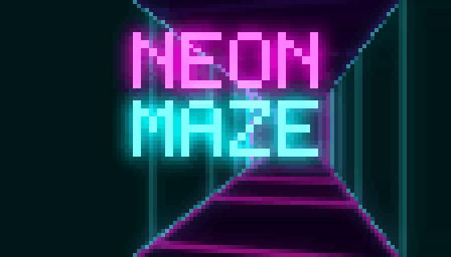

# Neon Maze

[](https://github.com/TeeBo8/neon-maze/actions/workflows/compilation.yml)

Un labyrinthe en 3D façon Wolfenstein, en couleurs 24 bits, à 60 images par seconde… **dans le terminal**. Un seul fichier C, aucune dépendance : on clone, on compile en une ligne, on joue.



Un nouveau labyrinthe à chaque partie, des murs en tubes de néon avec leur halo, un sol en grille synthwave, une minimap qui se dévoile au fil de l'exploration, et un portail doré à trouver le plus vite possible.

## Jouer

```bash
git clone https://github.com/TeeBo8/neon-maze.git
cd neon-maze
gcc -std=c99 -O2 -o neon-maze neon-maze.c -lm
./neon-maze          # labyrinthe de 10 x 10 couloirs
./neon-maze 20       # plus grand (de 4 à 30)
```

- **Linux** : `gcc` ou `clang`, déjà là ou à un `apt install gcc` près.
- **macOS** : `gcc` est fourni avec les outils en ligne de commande (`xcode-select --install`).
- **Windows** : installer GCC (par exemple `scoop install gcc`), puis lancer `.\neon-maze.exe` dans **Windows Terminal**.

| Touche | Action |
|---|---|
| Z / W ou ↑ | avancer |
| S ou ↓ | reculer |
| Q / A, D | pas de côté |
| ← → | tourner |
| Entrée ou Espace | commencer, rejouer |
| Échap ou Ctrl+C | quitter |

**Le terminal compte.** Il faut un terminal qui gère les couleurs 24 bits : Windows Terminal, iTerm2, kitty, WezTerm, Alacritty, GNOME Terminal ou Konsole. Celui de VS Code marche, mais saccade sur les grandes images. Plus la police est petite, plus l'image est fine : chaque caractère porte deux pixels.

## Comment ça marche

Tout le jeu tient dans [`neon-maze.c`](neon-maze.c), abondamment commenté en français. Les grandes idées :

### 1. Deux pixels par caractère

Le caractère `▀` (demi-bloc haut) a deux couleurs : celle du texte peint sa moitié haute, celle du fond sa moitié basse. Un terminal de 120 × 30 caractères devient ainsi un écran de 120 × 60 pixels, à peu près carrés.

```
┌───┐
│▀▀▀│  couleur du texte (38;2;R;G;B) → pixel du haut
│   │  couleur du fond  (48;2;R;G;B) → pixel du bas
└───┘
```

### 2. Un rayon par colonne d'écran (raycasting)

La carte est une grille vue de dessus. Pour chaque colonne de l'écran, on lance un rayon depuis le joueur jusqu'au premier mur. Plus le mur est loin, plus la colonne dessinée est courte : c'est toute la perspective.

```
    vue de dessus                      ce qu'on voit
  ################
  #      ▲       #                 ┌──────────────────┐
  #     /|\      #                 │   ▌          ▐   │
  #    / | \     #   colonne x  →  │ ▌ █ ▌      ▐ █ ▐ │
  #   /  |  \    #                 │ █ █ █ ████ █ █ █ │
  #  /   |   \   #                 │ ▌ █ ▌      ▐ █ ▐ │
  #      P       #                 │   ▌          ▐   │
  ################                 └──────────────────┘
   un rayon par colonne          hauteur = focale / distance
```

La direction du rayon de la colonne `x` vaut `regard + plan × caméra_x`, où `caméra_x` va de -1 (bord gauche) à +1 (bord droit). Le « plan caméra », perpendiculaire au regard, fixe le champ de vision : 0,66 donne environ 66°.

### 3. Avancer de bord de case en bord de case (DDA)

Plutôt que d'avancer à petits pas (lent, et on peut rater un coin), le rayon saute à chaque fois au **bord de case le plus proche**, vertical ou horizontal. C'est l'algorithme DDA. Il est exact et ne demande que quelques additions par case traversée.

```
  ┌───┬───┬───┬───┐
  │   │   │   │ ▓ │   ●  = points testés, toujours sur un bord de case
  ├───┼───┼───●───┤   ▓  = le mur touché
  │   │   ● ╱ │   │
  ├───┼───●───┼───┤
  │ P ● ╱ │   │   │
  └───┴───┴───┴───┘
```

### 4. Pas d'effet « fish-eye »

On mesure la distance **perpendiculaire au plan caméra**, pas la distance réelle au joueur. Sinon, les rayons des bords, plus longs, rendraient les murs droits bombés comme vus à travers un judas.

### 5. Le sol en grille

Pour le sol, on fait l'inverse : chaque ligne de pixels sous l'horizon montre le sol à une distance précise (`distance = focale / 2 / écart à l'horizon`). On en déduit le point du sol visé par chaque pixel, et s'il tombe près d'une coordonnée entière, il s'allume. La grille est donc exactement alignée sur les cases des murs. Au loin, les lignes deviennent plus fines qu'un pixel, et on les efface avant qu'elles ne fourmillent.

### 6. Les néons et leur halo

- **Les tubes** : on sait où le rayon a touché la face du mur (`wall_x`, de 0 à 1). Près de 0 ou de 1, on est sur une arête, et le pixel s'allume avec un cœur presque blanc. Une arête qui fait un vrai coin brille fort ; une jointure entre deux cases d'un même mur, à peine.
- **Le halo (bloom)** : chaque néon dépose aussi sa lumière dans un calque à part. Ce calque est flouté par un flou gaussien en deux passes (horizontale puis verticale : 26 lectures par pixel au lieu de 169 pour un flou en carré), puis ajouté à l'image.
- **Le brouillard** : chaque couleur est mélangée au violet du fond selon la distance.

### 7. Envoyer l'image vite

Le calcul d'une image prend moins d'une milliseconde ; le vrai coût, c'est le terminal. Pour qu'il suive à 60 images par seconde :

- toute l'image est préparée dans un tampon puis envoyée en **une seule écriture**, jamais en milliers de `printf` ;
- une couleur n'est renvoyée que si elle **change visiblement** (plus de 4 sur 255). Les dégradés du halo pèsent ainsi 40 % de moins ;
- chaque image est encadrée par la séquence de **sortie synchronisée** (`ESC [?2026h` … `ESC [?2026l`) : le terminal attend la fin avant d'afficher, et l'image n'apparaît jamais à moitié dessinée.

### 8. Le labyrinthe

- **Creusé par un « backtracker »** : on part d'une case, on creuse vers une voisine pas encore visitée, au hasard. Coincé, on revient sur ses pas grâce à une pile. À la fin, tout le labyrinthe est relié. Quelques murs sont ensuite ouverts en plus, pour créer des boucles.
- **La sortie est placée par un parcours en largeur** : on visite les cases à 1 pas du départ, puis à 2 pas, etc. La dernière case visitée est la plus éloignée, et le portail s'y place.

### 9. Le terminal rendu propre

Le jeu passe le terminal en mode brut (touches lues une à une, sans écho) et sur l'écran alternatif. En quittant, même par Ctrl+C ou par une erreur, tout est remis en état : couleurs, curseur, mode du clavier et contenu d'origine de l'écran.

## Organisation du code

Un seul fichier, en dix sections :

| Section | Contenu |
|---|---|
| 1. Réglages | vitesses, champ de vision, brouillard, néon, taille du labyrinthe |
| 2. Types | joueur, couleurs, écrans du jeu, état de la partie |
| 3. Carte | génération du labyrinthe, placement de la sortie, couleurs des zones |
| 4. Tampon d'image | les pixels et le calque de lumière |
| 5. Affichage | conversion en demi-blocs et en séquences de couleur, envoi groupé |
| 6. Raycasting | sol, murs, halo, minimap, grandes lettres néon |
| 7. Plateforme | tout ce qui dépend du système : Windows d'un côté, Linux et macOS de l'autre |
| 8. Clavier | quelles actions sont tenues en ce moment |
| 9. Restauration du terminal | remise en état à la sortie, messages d'erreur |
| 10. Boucle principale | déplacements, collisions, écrans, chrono, cadence de 60 images/s |

## Pour changer…

Tous les réglages sont des `#define` en haut de [`neon-maze.c`](neon-maze.c) :

| Je veux changer | Réglage |
|---|---|
| la vitesse de marche ou de rotation | `MOVE_SPEED`, `TURN_SPEED` |
| le champ de vision | `FOV_PLANE` |
| la distance du brouillard | `FOG_DISTANCE` |
| la taille par défaut du labyrinthe | `MAZE_SIZE` (ou `./neon-maze 20`) |
| le nombre de boucles dans le labyrinthe | `MAZE_LOOPS` |
| l'épaisseur des néons, la force du halo | `LINE_WIDTH`, `BLOOM_STRENGTH` |
| les couleurs | les `static const struct Color` de la section 2 |
| la carte ou ses symboles | section 3 (`'#'`, `'M'`, `'L'` pour les murs, `'X'` pour la sortie) |

Compiler en mode strict, comme le fait l'intégration continue :

```bash
gcc -std=c99 -O2 -Wall -Wextra -Wpedantic -o neon-maze neon-maze.c -lm
```

## Portabilité

Le code est en C99 strict, avec la bibliothèque standard et `math.h`. Tout ce qui dépend du système est isolé dans une section `#ifdef _WIN32` :

- **Windows** : API console (lecture des touches enfoncées ou relâchées, minuterie haute précision) ;
- **Linux et macOS** : `termios` en mode brut, `clock_gettime`, `nanosleep`.

À chaque push, [GitHub Actions](.github/workflows/compilation.yml) compile le jeu sur Windows, Linux et macOS (gcc, plus clang sous Linux), le moindre avertissement faisant échouer la compilation. Sous Linux, il lance aussi le jeu dans un faux terminal et vérifie qu'il quitte proprement avec Échap.

**Limites connues :**

- Sous Linux et macOS, un terminal ne dit pas quand une touche est relâchée, et ne répète que la dernière enfoncée. Tenir deux touches à la fois (avancer en tournant) marche donc moins bien que sous Windows : au bout d'une demi-seconde, seule la dernière enfoncée reste active.
- Dans un terminal réglé en chinois, japonais ou coréen, `▀` peut s'afficher sur deux cases et décaler l'image.

## Licence

Le code est sous licence [MIT](LICENSE) : vous pouvez le réutiliser, le modifier et le redistribuer librement, en gardant la mention de copyright.

Projet de [TeeBo Studio](https://teebostudio.fr).
